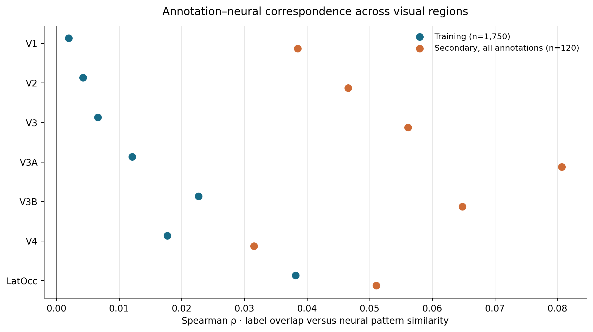
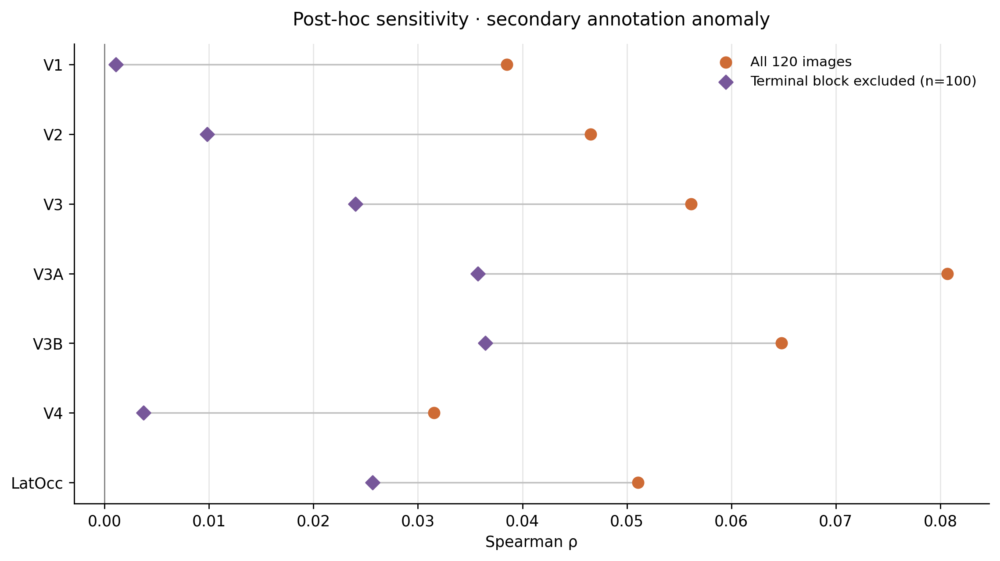

# Semantic representations in visual cortex

**An exploratory fMRI study using representational similarity analysis.**

Do images with similar category labels evoke similar patterns of activity in visual cortex? This project compares DNN-derived image annotations with fMRI responses to **1,750 natural images across seven visual regions**, using data distributed by Neuromatch Academy from Kay et al. (2008).

The analysis combines regional RSA, stimulus-label permutation tests, and sensitivity analyses. An annotation audit also identifies a repeated-label anomaly in a separate 120-image split and examines its influence on the results.

[Analysis notebook](notebooks/fmri_semantic_rsa.ipynb) · [Main findings](#main-findings) · [Annotation audit](#annotation-quality-and-its-impact) · [Run locally](#run-locally)

## Main findings

- **Small associations, strongest in LatOcc in the training set.** Label–neural correspondence was largest in lateral occipital cortex (Spearman ρ = 0.0382), compared with ρ = 0.0020 in V1.
- **Little dependence on the two weighting schemes tested.** Weighted and equal-weight category overlap produced nearly identical training estimates; the largest regional difference was 0.000068.
- **Substantial sensitivity to a secondary-split annotation anomaly.** Excluding 20 images with identical, implausible annotations reduced correlations in every region. LatOcc decreased from 0.0511 to 0.0257; V3A decreased from 0.0807 to 0.0357.



*Points show Spearman correlations between label similarity and neural-pattern similarity. The secondary estimates include the anomalous annotation block examined below. Regional differences are descriptive; the figure does not show confidence intervals.*

## Approach

Each image has a response vector across voxels and four supplied annotation entries: three WordNet-related category levels and one class predicted by an ImageNet-trained neural network. The notebook loads these annotations; it does not train or run the classifier.

| Step | Method |
|---|---|
| Define label similarity | Weighted exact matches across the three supplied category levels, with weights `(1, 2, 3)`. |
| Define neural similarity | Pearson correlation between image-response patterns across voxels within each ROI. |
| Compare representations | Spearman correlation between the strict upper triangles of the label and neural similarity matrices. |
| Estimate significance | Joint row-and-column stimulus permutations, with shared permutations across ROIs and a maximum-absolute-statistic correction across seven regions within each split. |
| Examine robustness | Equal weights, individual label levels, exact predicted-class matching, and exclusion of the anomalous terminal block. |

The training analysis uses 1,999 permutations; the full secondary analysis uses 4,999. Image pairs are dependent because each image participates in many pairs, so inference permutes stimulus identities rather than treating pairs as independent observations.

## Annotation quality and its impact

The supplied annotations contain image–label mismatches and inconsistent category relationships. Most conspicuously, secondary images **100–119** all have the tuple `animal → acorn → acorn → Afghan hound`, despite depicting varied content.

This directly changes the model being tested. All **190 pairs** within that block receive maximum label similarity, and their similarities to other images also depend on those annotations. Incorrect labels can weaken, inflate, or otherwise alter RSA estimates; permutation significance cannot establish that the semantic model is accurate.



*Every regional estimate decreases when the final 20 images are excluded. Lines connect estimates from the two image samples; they are not confidence intervals.*

| Region | Training: 1,750 images | Secondary: all 120 | Secondary: final 20 excluded |
|---|---:|---:|---:|
| V1 | 0.00195 | 0.03849 | 0.00108 |
| V2 | 0.00425 | 0.04655 | 0.00983 |
| V3 | 0.00660 | 0.05614 | 0.02403 |
| V3A | 0.01210 | 0.08069 | 0.03573 |
| V3B | 0.02269 | 0.06479 | 0.03645 |
| V4 | 0.01771 | 0.03154 | 0.00373 |
| LatOcc | 0.03816 | 0.05106 | 0.02565 |

*Values are Spearman ρ, rounded from the executed notebook. The reduced-sample comparison is descriptive and post hoc.*

Exclusion changes both the stimulus sample and its annotation structure, so this comparison does not isolate annotation-error bias or establish that the remaining labels are correct. The full and reduced analyses are both retained. The training audit identifies additional mismatches but does not quantify their overall prevalence or effect on training estimates.

## Data and scope

| Property | Distributed data |
|---|---|
| Main image set | 1,750 grayscale images, 128 × 128 pixels |
| Secondary image set | 120 images |
| Response measurements | 8,428 voxels; z-scored BOLD response amplitudes |
| Regions | V1, V2, V3, V3A, V3B, V4, LatOcc |
| Annotation source | Supplied DNN predictions and associated WordNet-related label rows |
| Participant provenance | No explicit participant identifiers in the distributed archive |

“Training” and “secondary” refer to the supplied image sets; this project fits no predictive model. The secondary set has been inspected during development and is exploratory.

The findings concern correspondence with the supplied label model. Regional estimates may also reflect unequal voxel counts, response reliability, and visual features correlated with category labels. The project does not establish a significant LatOcc–V1 difference, replication across participants, or correspondence between CNN layers and cortical regions.

A useful next step is to establish annotation and participant provenance, then compare a documented semantic model with a low-level visual-feature baseline.

## Run locally

Clone the repository, then install the dependencies and launch Jupyter:

```bash
git clone https://github.com/dianaseh/fMRI-semantic-RSA.git
cd fMRI-semantic-RSA
python -m pip install -r requirements.txt notebook
python -m notebook
```

Open `notebooks/fmri_semantic_rsa.ipynb` and run all cells. The notebook downloads the required data and exports figures and result tables to `fmri_rsa_outputs/`.


## Repository contents

| Path | Contents |
|---|---|
| `notebooks/fmri_semantic_rsa.ipynb` | Executed analysis, figures, and interpretation. |
| `figures/` | Seven composite figures exported by the notebook. |
| `results/` | Small CSV summaries and `analysis_metadata.json` from the recorded run. |
| `requirements.txt` | Packages needed to run the notebook locally. |
| `.gitignore` | Exclusions for downloaded data, caches, environments, and temporary files. |

## Project origins and contributions

This work originated as a Neuromatch Academy Computational Neuroscience course project. The original team consisted of me, **Fereshteh Fathi, Erfaneh Hosseini, and Paniz Kheyri**.

The project was supported by **Dr. Mahdie Soltaninejad** (project TA), **Dr. Ladan Shahshahani** (project mentor), and **Dr. Reza Seifooripour** (pod TA).

Following the course, I independently developed this revised version, building on the team's original work. The revision expands the annotation audit, adds sensitivity analyses, improves the visualizations and interpretation, and strengthens reproducibility. AI assistance was used for code and writing support during the revision.

## References and data attribution

- Kay, K. N., Naselaris, T., Prenger, R. J., & Gallant, J. L. (2008). *Identifying natural images from human brain activity.* Nature, 452, 352–355. [DOI](https://doi.org/10.1038/nature06713)
- Kriegeskorte, N., Mur, M., & Bandettini, P. A. (2008). *Representational similarity analysis—connecting the branches of systems neuroscience.* Frontiers in Systems Neuroscience, 2, 4. [DOI](https://doi.org/10.3389/neuro.06.004.2008)
- Nili, H., et al. (2014). *A toolbox for representational similarity analysis.* PLOS Computational Biology, 10(4), e1003553. [DOI](https://doi.org/10.1371/journal.pcbi.1003553)
- Neuromatch Academy. [Kay-image data loading notebook](https://github.com/NeuromatchAcademy/course-content/blob/main/projects/fMRI/load_kay_images.ipynb).

The underlying data and stimulus images are third-party materials. Data are downloaded from the course-provided endpoints rather than redistributed in this repository. The diagnostic galleries contain examples from those stimuli and should retain this attribution.
